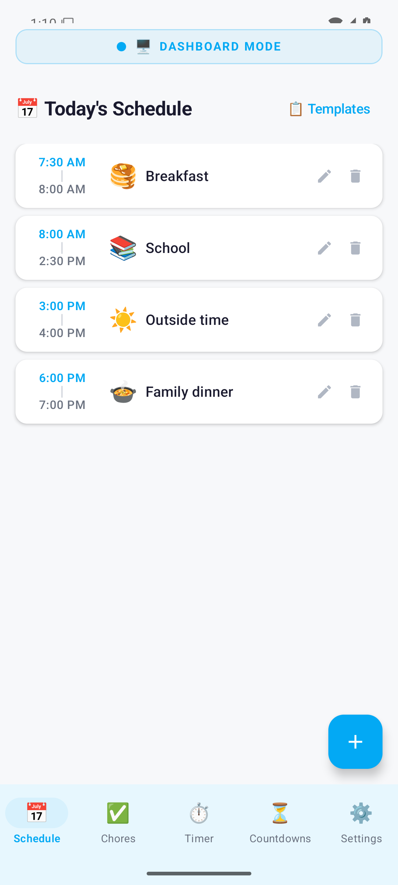
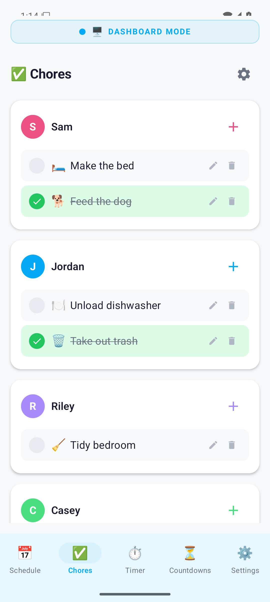
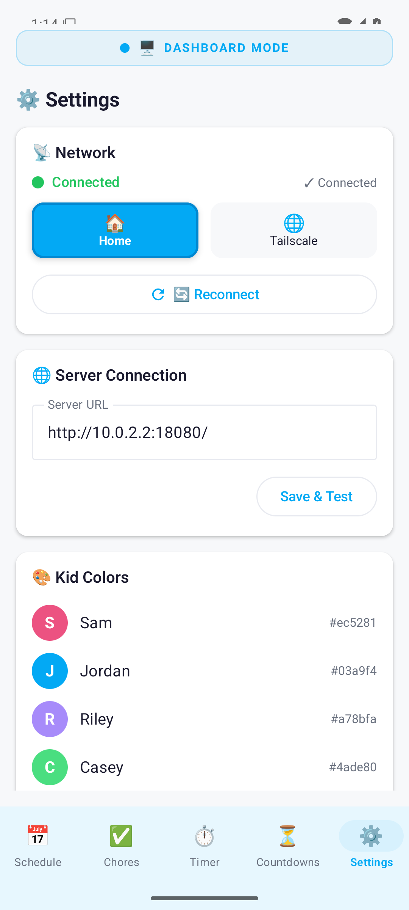

# 📱 Graber Hub — Android Companion

The parent-side controller for [Graber Hub](https://github.com/JasonGraber/graber-hub), an open-source Raspberry Pi family command center.

<p align="center">
  
  
  
</p>

[](LICENSE)


## What it does

The wall display keeps the family aligned; this app lets a parent update it without standing at the screen.

- Build and edit the day's schedule.
- Add one-time or recurring chores and mark them complete.
- Keep unfinished chores at the top automatically.
- Start a shared timer and manage event countdowns.
- Add Bible verses and choose the active verse.
- Upload, rename, and remove slideshow photos.
- Switch the wall between Dashboard, Photos, and Auto modes.
- Connect over home Wi-Fi, Tailscale, or a custom server URL.

## Requirements

- Android 8.0+ (API 26)
- A running [Graber Hub server](https://github.com/JasonGraber/graber-hub)
- Same trusted Wi-Fi network as the Pi, or the same Tailscale network

## Install from source

### 1. Clone

```bash
git clone https://github.com/JasonGraber/graber-hub-app.git
cd graber-hub-app
```

### 2. Configure the Android SDK

Create an ignored `local.properties`:

```properties
sdk.dir=/absolute/path/to/Android/Sdk
```

Optional build-time defaults:

```properties
graberHub.homeUrl=http://192.168.1.50/
graberHub.tailscaleUrl=http://100.64.0.10/
```

These are conveniences, not credentials. Keep real private addresses out of commits. Users can enter the Hub URL from the app.

### 3. Build

```bash
./gradlew assembleDebug
```

The APK is written to:

```text
app/build/outputs/apk/debug/graber-hub-1.4.9.apk
```

### 4. Install

```bash
adb install -r app/build/outputs/apk/debug/graber-hub-1.4.9.apk
```

### 5. Connect

Open **Settings → Server Connection**, enter `http://PI_ADDRESS/`, and tap **Save & Connect**. Keep the trailing slash.

For full environment setup, emulator networking, verification, and the regression checklist, read [Android Setup and Development](docs/DEVELOPMENT.md).

## Project structure

```text
app/src/main/java/com/graberhub/companion/
├── MainActivity.kt                 # Compose shell and bottom navigation
├── alarm/AlarmService.kt           # Timer alarm foreground service
├── data/
│   ├── models/Models.kt            # API models
│   └── prefs/PrefsManager.kt       # URLs, colors, local templates
├── network/
│   ├── ApiService.kt               # REST contract
│   └── RetrofitClient.kt           # Client and data-version interceptors
├── ui/
│   ├── components/                 # Shared Compose components
│   ├── navigation/NavGraph.kt      # Routes
│   ├── screens/                    # Schedule, chores, timer, etc.
│   └── theme/                      # Colors and typography
└── viewmodel/MainViewModel.kt      # Shared state and mutations
```

## Technical notes

- Kotlin, Jetpack Compose, Material 3
- MVVM with StateFlow and coroutines
- Retrofit + Gson
- Min SDK 26 / Target SDK 35
- Optimistic concurrency through `X-Data-Version`
- Foreground auto-refresh on active screens

## Agent-assisted development

[AGENTS.md](AGENTS.md) is the operational handoff: invariants, source-of-truth files, local configuration, build gates, and release discipline.

```bash
./gradlew clean compileDebugKotlin lintDebug assembleDebug
```

## Security

The app intentionally allows local cleartext HTTP. Use it only with a trusted LAN or private VPN, never a Hub API exposed directly to the Internet. See [SECURITY.md](SECURITY.md).

## Contributing

Pull requests are welcome. Read [CONTRIBUTING.md](CONTRIBUTING.md), use fictional screenshots/data, and include build plus manual UI results.

## License

[MIT](LICENSE) © 2026 Jason Graber
